<div align="center">

# 📸 IG Studio

**Your Instagram skills, as an app. Write, check and analyse, without an API key.**

A local web app on top of the `ig-*` Claude Code skills. Write reels, captions, carousels, stories and DMs in your own voice, score them before you post, and audit what you've already posted in a Studio-style analytics dashboard. Writing runs through **Claude Code** with your existing Claude login, so there's no API key and no per-token bill.

Built by **Raghav** · Python (standard library only) · Vanilla JS · Claude Code

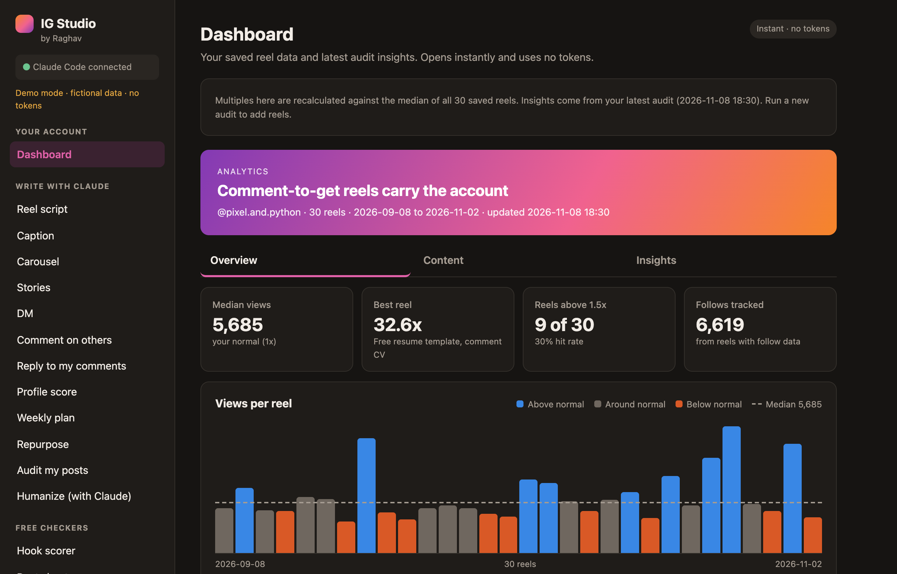

</div>

## 🎬 Demo


> Screenshots and demo use a fictional account (`python3 demo_seed.py`).

## ✨ Features

| | |
|---|---|
| **📊 Analytics dashboard** | Studio-style Overview / Content / Insights. Views per reel against your median, reach from non-followers, performance by content type, sortable content table. Opens instantly from saved data with **no tokens**. |
| **✍️ 12 writing tools** | Reel script, caption, carousel, stories, DM, comments on others, replies to your comments, profile score, weekly plan, repurpose, audit, humanize. Each runs the matching skill in Claude Code. |
| **🔑 No API key** | Jobs run through the Claude Code that ships with the Claude desktop app, signed in with your Claude plan. |
| **⏱️ Live progress & cancel** | See each step as it happens ("Loading the ig-reel playbook", "Running the hookscore.py checker"), a running token count, and a Cancel button that stops Claude Code and everything it started. |
| **🧮 Token usage** | Tokens per job (new input, cache, written), the API-equivalent cost (not charged on a plan) and a running total for the day. |
| **💾 Saves everything** | Every result is saved on disk and reopens from a "Saved results" menu. Audits merge their reels into one file, so the next audit only analyses new reels. |
| **🆓 6 free checkers** | Hook scorer, beat sheet, caption check, strip AI tells, AI detector, viral ranker. They run the skills' own Python scripts instantly, with no Claude usage. |
| **🗣️ Your voice** | Edit `voice.md`, `log.md` and `swipe.md`, the files the skills read so drafts sound like you and plans don't repeat. |
| **🌗 Light / Dark / System** | Plus tooltips on every tool explaining what it does. |

## 📸 Screenshots

| Hover any reel | Content table (sortable) |
|---|---|
| 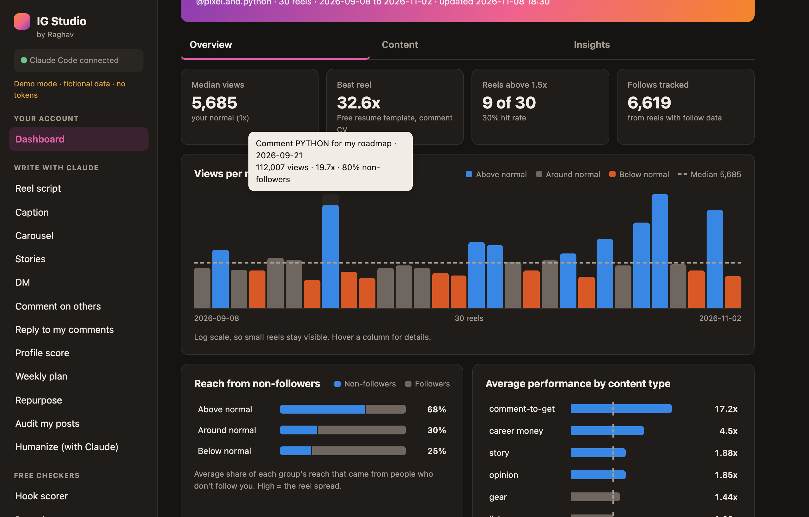 | 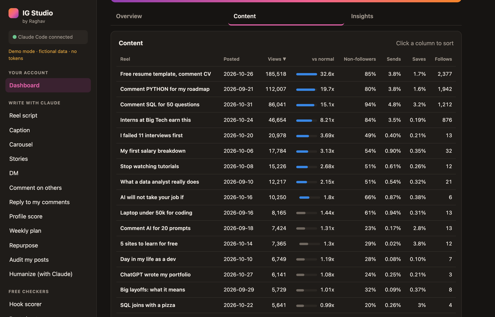 |

| Reach & content types | Insights |
|---|---|
| 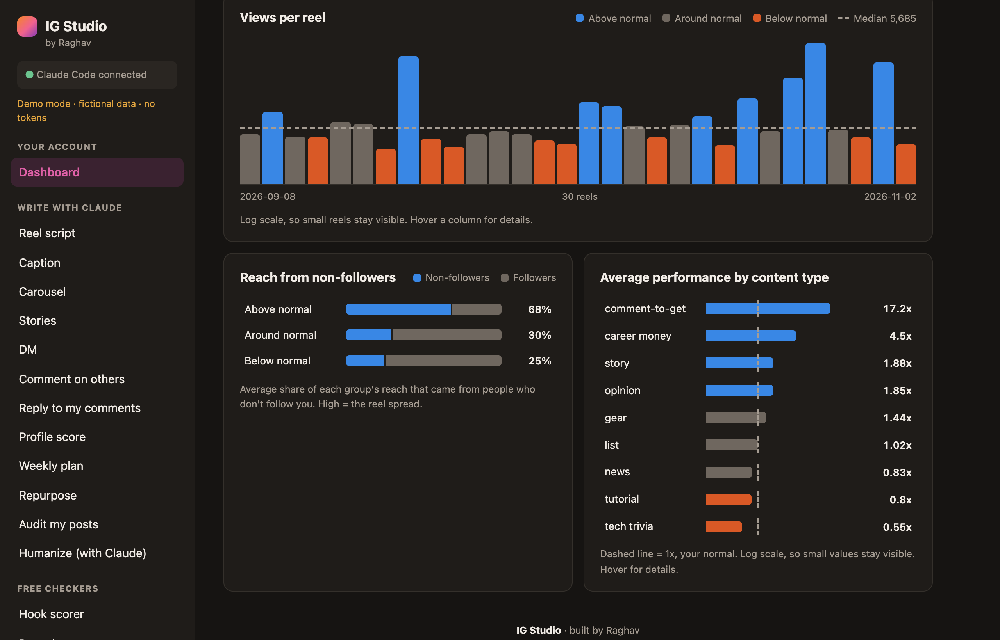 | 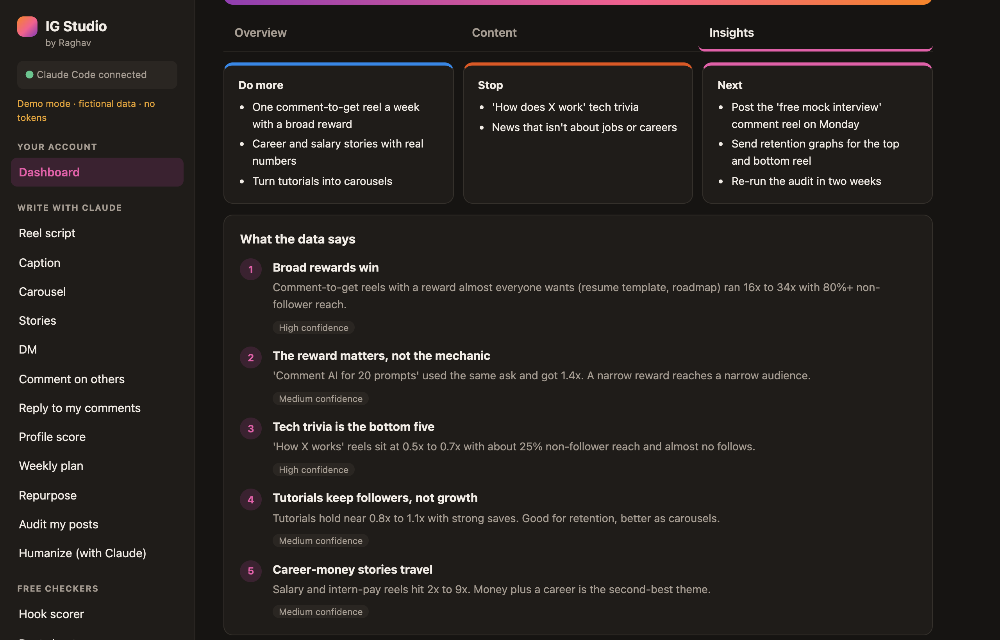 |

| Live progress & cancel | Finished reel script |
|---|---|
| 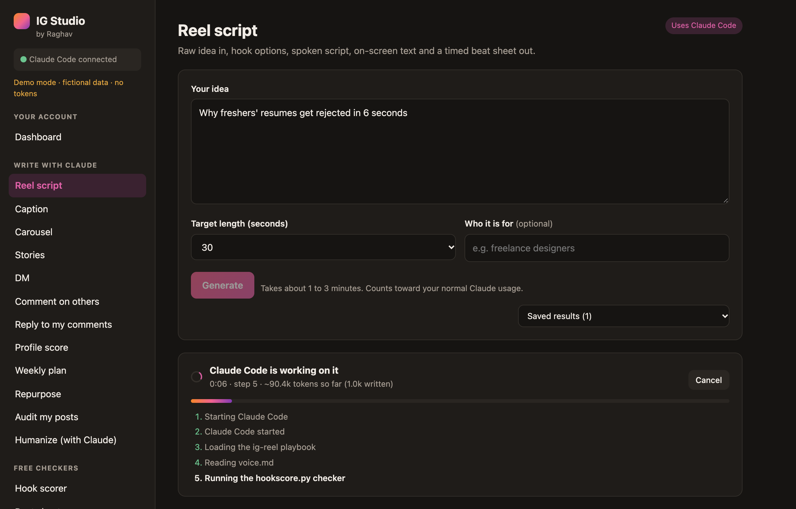 | 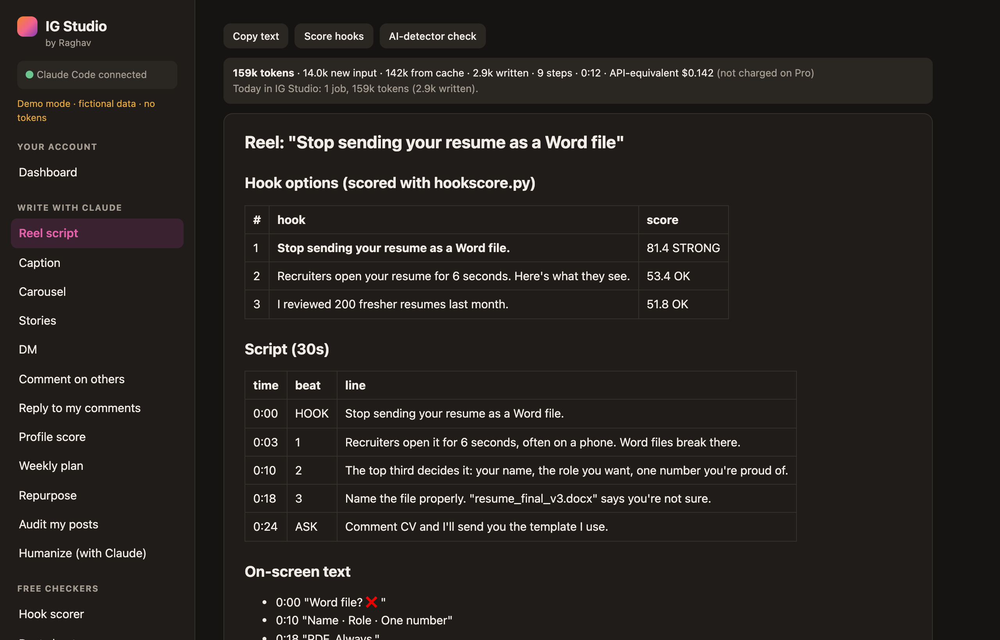 |

| Profile score | Light mode |
|---|---|
| 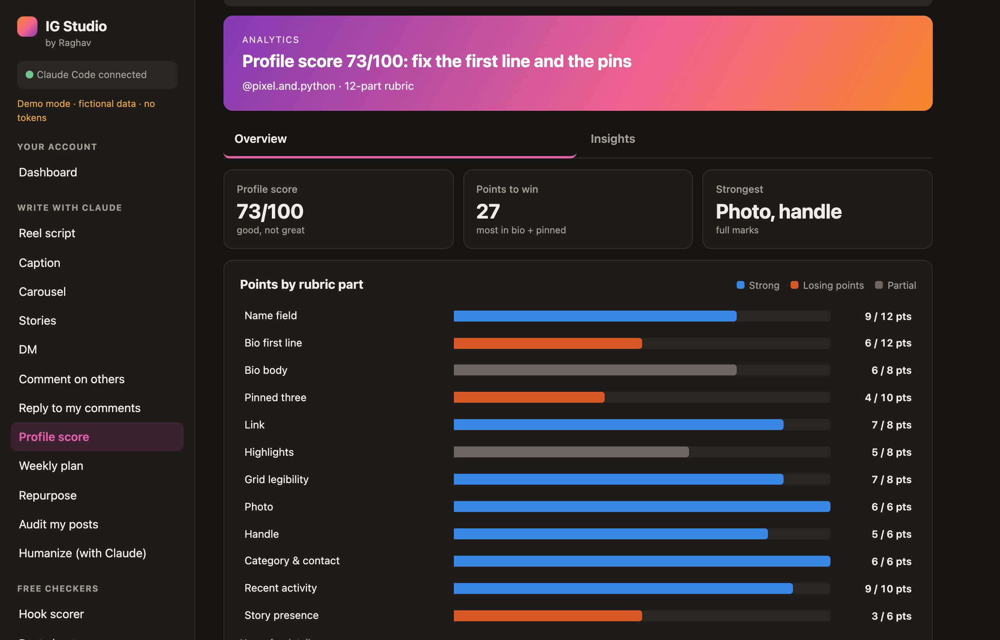 | 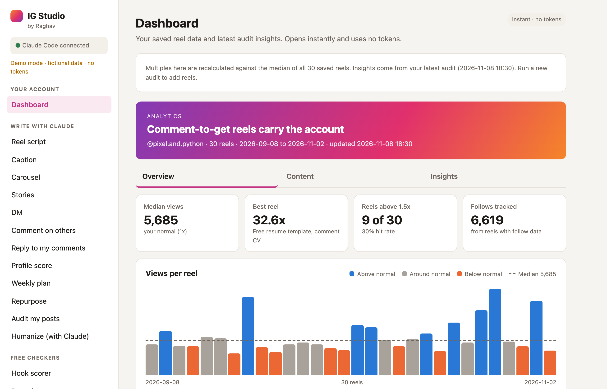 |

| Hook scorer (free) | Strip AI tells (free) |
|---|---|
| 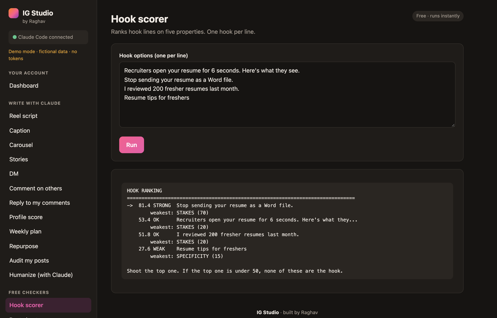 | 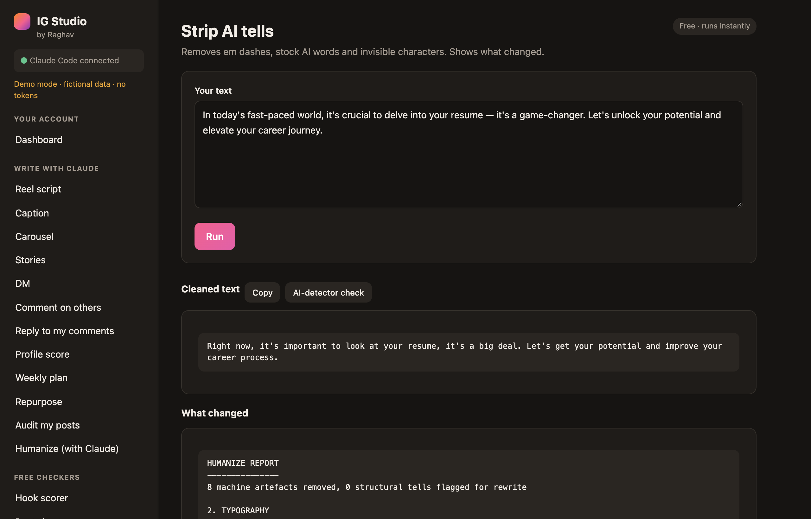 |

## 🚀 Quick start

You need:
- **macOS** with **Python 3** (no packages to install).
- The **Claude desktop app** (or the Claude Code CLI), signed in. The app finds the `claude` command on its own.
- The **`ig-*` skills** installed in `~/.claude/skills/` (`ig-reel`, `ig-caption`, `ig-audit`, …).

```bash
python3 app.py          # http://127.0.0.1:8765
```

Or double-click **`start.command`** (the first time: right-click → Open). It starts the app and opens your browser.

## 🎭 Demo mode

Try the whole app with a fictional account. No Claude calls and no tokens: writing tabs replay a sample run.

```bash
python3 demo_seed.py    # fictional data in demo-data/
python3 app.py --demo   # http://127.0.0.1:8766
```

Regenerate the screenshots and GIF (headless Brave or any Chromium browser, plus ffmpeg):

```bash
node scripts/screenshots.mjs
```

## 🧠 How it works

```
Browser  ──►  app.py (127.0.0.1 only)
               ├─ Writing tabs  ──►  claude -p  (your Claude login)  ──►  ~/.claude/skills/ig-*/SKILL.md
               │                     streams steps + tokens back; Cancel kills the process group
               ├─ Free checkers ──►  python3 ~/.claude/skills/ig-*/*.py --json
               └─ Storage       ──►  data/results/*.json         (every result)
                                     ~/.claude/instagram/reels.json  (merged reels, shared with Claude in chat)
```

- Audit and Profile score ask Claude for a small JSON block alongside the written report. The page draws the dashboard from it.
- The Dashboard recalculates multiples against the median of all saved reels, so it never needs Claude.
- Results made before saving existed are moved from the browser to disk on first load.

## 🔒 Privacy

Everything stays on your Mac. The server listens on `127.0.0.1` only. Claude Code is told not to browse, post or send anything. Your results (`data/`) and reel data (`~/.claude/instagram/`) are never part of this repo.

## 📌 Versions

- **1.0**: first release. Dashboard, 12 writing tools with live progress, cancel and token usage, 6 free checkers, saved results and reel database, demo mode, light/dark theme, "by Raghav".

---

<div align="center">

**IG Studio** · built by Raghav

</div>
